<div align="center">

**🌐 English | [简体中文](README_CN.md)**

</div>

# 🎹 Gesture Rhythm Master - Piano Mode

A real-time, gesture-recognized piano rhythm game built on **MediaPipe Hands**. Players need no physical keyboard at all — simply align both hands' ten fingers with the notes falling on screen in front of the camera, and **bend the corresponding finger** at the right moment to "play" it; in menus, **move your palm** to control the cursor and **make a fist** to click.

> Uses real piano samples from the 88 keys (`Piano/` directory) for sound synthesis, and supports sharp/flat note mapping.

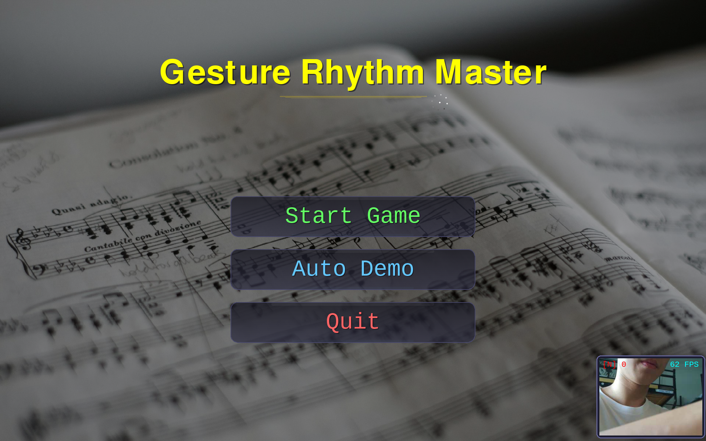

---

## ✨ Features

- 🖐️ **Fully visual gesture control**: Both hands' 10 fingers map to 10 tracks respectively, for completely contactless play.
- 🎯 **Three gesture semantics**: Cursor movement (hand center), menu click (fist), and note hit (finger bend / tap).
- 🎵 **Real piano timbre**: 88 monophonic `tone(N).wav` samples, dynamically loaded and pitch-mapped by note name.
- 📝 **Notes carry their own note names**: Each falling note is directly labeled with its real note name (e.g. `C#5`, `G#4`), so sharp and flat notes are also displayed and sounded correctly.
- 📈 **Four-level timing judgment**: PERFECT / GREAT / GOOD / MISS counted independently, with combo and accuracy statistics.
- 🎚️ **Three difficulty levels**: Easy / Normal / Hard correspond to different note fall speeds.
- 🎬 **Seven built-in songs**: Twinkle Twinkle Little Star, Happy Birthday, Jingle Bells, Farewell, Ode to Joy, Moonlight Sonata, Night Piano No.5.
- 🖥️ **Full screen + camera**: Full-screen game, with a live camera preview (including hand skeleton overlay) in the bottom-right of the sidebar.
- 🤖 **Demo mode**: Auto-plays when no gestures are detected; ends with a separate "Demo Complete!" results screen.
- 🎨 **Smooth UI animations**: Menu buttons fade in quickly, glowing title texture, note glow pulse and trail light effects.

---

## 🔧 Hardware Configuration

This project has been verified on a **Raspberry Pi 5**, but the architecture is also suitable for any Linux/macOS/Windows machine with a camera.

| Component | Description |
| --- | --- |
| Host | Raspberry Pi 5 (4GB RAM, 32GB SD card), running **Ubuntu 24.04 (arm64)** |
| Camera | Raspberry Pi Camera Module 3 (CSI interface), outputting an MJPEG stream via `rpicam-vid` (libcamera) |
| Display | 1920×1200 HDMI monitor |
| Audio | USB speaker, `pygame.mixer` plays the samples |
| Keyboard | USB keyboard, used only for `ESC` to quit, `SPACE` to pause, `Q` to quit |

### Camera data stream (named pipe)

The game does **not** call `cv2.VideoCapture(0)` directly. Instead, `CameraManager` launches `rpicam-vid` to write an MJPEG stream into a named pipe `/tmp/camera_pipe`, which OpenCV then reads via `CAP_FFMPEG`. This circumvents the compatibility issues between `libcamera` and OpenCV direct capture on the Raspberry Pi:

```python
class CameraManager:
    def __init__(self, fps=60):
        ...
        self.pipe_path = '/tmp/camera_pipe'
        ...
        os.mkfifo(self.pipe_path)
        cmd = [
            'rpicam-vid',
            '-t', '0',
            '--width', '320',
            '--height', '240',
            '--framerate', str(fps),
            '--codec', 'mjpeg',
            '--nopreview',
            '--output', self.pipe_path
        ]
```

**Camera capture spec**: `rpicam-vid` captures at **320×240** resolution, default **60 FPS** (MJPEG), and writes to the named pipe; OpenCV reads it via `CAP_FFMPEG`, mirrors it, then scales it to a **280×210** preview window drawn at the bottom-right of the interface. The actual achievable frame rate depends on the Pi 5's load (gesture inference + rendering); the program shows the current `camera_fps` in real time at the corner of the preview window.

> If using a regular USB/built-in camera, you can change `CameraManager` to `cv2.VideoCapture(0)` (and remove the `rpicam-vid`-related logic); the rest of the gesture pipeline is fully reused.

### Target frame rate

The standard **target frame rate is 60 FPS** (`TARGET_FPS = 60`), maintained by a dual mechanism of "computational precise frame limiting (`time.sleep` filling the per-frame remainder) + `pygame.clock.tick` as a fallback". The actual frame rate depends on the host load (MediaPipe gesture inference + Pygame rendering).

---

## 🚀 How to Run

### 1. Install dependencies

**System layer** (Ubuntu 24.04 arm64):

```bash
sudo apt update
sudo apt install -y python3 python3-pip rpicam-apps   # rpicam-apps provides rpicam-vid
```

**Python dependencies** (see `requirements.txt`):

```bash
pip3 install -r requirements.txt
```

| Dependency | Purpose |
| --- | --- |
| `opencv-python` | Camera frame reading, BGR↔RGB conversion, mirroring, drawing keypoints |
| `mediapipe` | `solutions.hands` provides the 21-point hand keypoint model |
| `pygame` | Game rendering, event loop, audio mixing |
| `numpy` | Coordinate computation and numerical processing |

> The program sets `MEDIAPIPE_DISABLE_GPU=1` and `TF_CPP_MIN_LOG_LEVEL=3`, forcing MediaPipe to run on the **CPU** and suppressing logs, suitable for GPU-less environments such as the Raspberry Pi.

### 2. Prepare piano samples

```bash
mkdir -p ~/Piano
cp -r Piano/* ~/Piano/        # The program reads tone(N).wav from ~/Piano by default
```

### 3. Run

**Method A: Raspberry Pi (CSI camera + rpicam-vid)**

```bash
# Make sure the camera is connected and enabled in raspi-config
python3 game.py
```

**Method B: Regular computer (USB/built-in camera)**

Change `CameraManager` in `game.py` to use `cv2.VideoCapture(0)`, and place the samples into `~/Piano`; the other steps are the same:

```python
# Replace CameraManager's initialization logic with:
self.cap = cv2.VideoCapture(0, cv2.CAP_ANY)
```

> ⚠️ **Unverified**: Method B is only a reference modification for compatibility with regular cameras. The project has not been actually tested in non-Raspberry Pi environments (CSI camera + rpicam-vid). Whether the gesture pipeline is fully usable depends on the specific camera and driver; please verify on your own.

### 4. In-game controls

| Action | Gesture / Key |
| --- | --- |
| Move menu cursor | Move palm left/right or up/down |
| Confirm / click | Make a fist (hold for about 3 frames) |
| Play a note | Bend the corresponding finger when the note reaches the judgment line |
| Pause | `SPACE` (in-game) |
| Auto-pause | In non-demo mode, if no hand is detected for several consecutive frames, auto-pause and prompt |
| Exit current screen | `ESC` |
| Quit the program | `Q` |

---

## 🤚 Gesture Recognition Implementation (Core)

This is the focus of the project. The entire recognition pipeline is shown in the figure below:

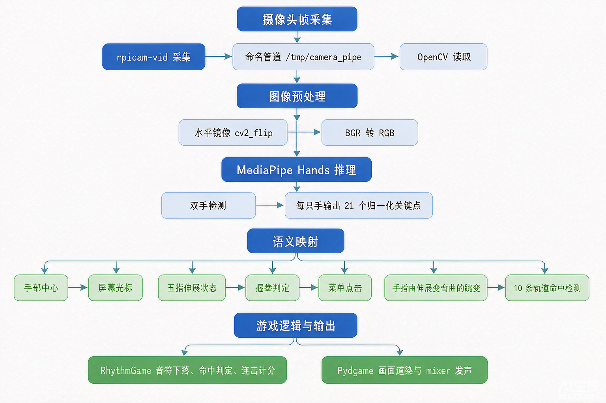

Summarized as:

```
Camera frame ──► [mirror flip] ──► [BGR→RGB]
        ──► MediaPipe Hands ──► 21 keypoints (normalized 0~1)
        ──► ① Hand center → screen cursor
        ──► ② Per-finger extension state → fist detection → menu click
        ──► ③ Finger "extend→bend" jump → note hit on the corresponding track
```

### 1. Hand keypoint detection (MediaPipe Hands)

Initialize a lightweight model that can detect **two hands** (`model_complexity=0` guarantees real-time performance on the Raspberry Pi):

```python
hands = mp_hands.Hands(
    static_image_mode=False,
    max_num_hands=2,
    model_complexity=0,
    min_detection_confidence=0.5,
    min_tracking_confidence=0.3
)
```

In the main game loop, each frame the mirrored RGB frame is fed into the model, yielding 21 normalized keypoints `hand_landmarks` and the left/right hand label `handedness` for each hand:

```python
if frame is not None and camera_available:
    frame = cv2.flip(frame, 1)
    camera_fps = camera.get_fps()
    rgb_frame = cv2.cvtColor(frame, cv2.COLOR_BGR2RGB)
    results = hands.process(rgb_frame)

    if results.multi_hand_landmarks:
        hand_detected = True
        hand_count = len(results.multi_hand_landmarks)
        for idx, (hand_landmarks, handedness) in enumerate(
                zip(results.multi_hand_landmarks, results.multi_handedness)):
            is_left = handedness.classification[0].label == 'Left'
            finger_states = get_finger_states(hand_landmarks, is_left)
```

Keypoint index convention (MediaPipe Hands):

- `0` wrist; `1/5/9/13/17` the five fingers' MCP (metacarpophalangeal) joints; `2/6/10/14/18` PIP (proximal interphalangeal) joints; `3/7/11/15/19` DIP (distal interphalangeal) joints; `4/8/12/16/20` fingertips.
- The thumb uses the **x** direction of `3` (IP interphalangeal joint) ↔ `4` (fingertip) to judge; the other fingers use the **y** direction of the fingertip vs. the PIP (point `6/10/14/18`).

### 2. Mirroring and coordinate normalization

The camera frame is first horizontally mirrored `cv2.flip(frame, 1)` to form natural "mirror" interaction; the keypoint coordinates output by MediaPipe are normalized values `[0,1]` relative to the image, and are scaled up by the screen resolution later when used for the cursor and gesture detection.

### 3. Gesture ①: Hand center → screen cursor

Take the 5 reference points of the palm region (wrist + four MCPs) and average them as the "hand center":

```python
def get_hand_center(hand_landmarks):
    lm = hand_landmarks.landmark
    x = (lm[0].x + lm[5].x + lm[9].x + lm[13].x + lm[17].x) / 5
    y = (lm[0].y + lm[5].y + lm[9].y + lm[13].y + lm[17].y) / 5
    return x, y
```

Normalize the center's offset from the screen center to `[-1,1]`, then multiply by the sensitivity coefficient `MOUSE_SCALE=5.0` to map to full-screen coordinates, and apply **exponential smoothing** (smoothing coefficient 0.55, balancing follow-speed and jitter resistance):

```python
if idx == 0:
    hx, hy = get_hand_center(hand_landmarks)
    center_x = 0.5; center_y = 0.5
    offset_x = (hx - center_x) * 2   # [-1, 1]
    offset_y = (hy - center_y) * 2
    screen_x = SCREEN_WIDTH // 2 + offset_x * SCREEN_WIDTH * MOUSE_SCALE / 2
    screen_y = SCREEN_HEIGHT // 2 + offset_y * SCREEN_HEIGHT * MOUSE_SCALE / 2
    screen_x = max(margin, min(SCREEN_WIDTH - margin, screen_x))
    screen_y = max(margin, min(SCREEN_HEIGHT - margin, screen_y))
    mouse_x = mouse_x * (1 - 0.55) + screen_x * 0.55   # low-pass smoothing
    mouse_y = mouse_y * (1 - 0.55) + screen_y * 0.55
```

> `MOUSE_SCALE=5.0` means the palm only needs to move about **1/5** of the frame range to sweep across the entire screen, suitable for standing and playing at a distance; it can be lowered for a better feel.

#### Single-hand priority: only the first hand controls the cursor

The main loop uses `enumerate(...)` to iterate over the detected two hands, but **only the hand with index `idx == 0`** participates in cursor mapping and fist detection:

```python
if idx == 0:
    hx, hy = get_hand_center(hand_landmarks)
    ...
    mouse_x = mouse_x * (1 - 0.55) + screen_x * 0.55   # low-pass smoothing
    mouse_y = mouse_y * (1 - 0.55) + screen_y * 0.55

    if is_fist(finger_states, is_left):
        fist_timer += 1
        if fist_timer >= FIST_THRESHOLD:
            is_fisting = True
    else:
        fist_timer = 0
        is_fisting = False
```

That is to say:

- The first hand detected by MediaPipe → drives **screen cursor movement** + triggers **fist click**;
- The second hand (if present) → only provides `finger_states` for **note playing**, does not affect the cursor.

The benefit of this design is: while playing, a hand hovering near the menu won't "steal" the cursor, and the other hand can focus on playing; the cost is that the cursor always follows the first-detected hand, and if the hand order changes, the cursor may briefly jump.

#### Cursor state machine (`Cursor` class)

Each frame the main loop feeds `(mouse_x, mouse_y, is_fisting)` into `Cursor.update()`. Based on this, `Cursor` maintains a **click state machine**, working with the "fist hysteresis" in Section 5 to achieve stable clicks:

| Field | Meaning |
| --- | --- |
| `click_hold_frames` | Current consecutive fist frames; when it reaches `CLICK_HOLD_THRESHOLD=10`, it is judged as one valid click |
| `click_progress` | `click_hold_frames / CLICK_HOLD_THRESHOLD`, value `[0,1]`, used to draw the **ring countdown progress bar** |
| `click_available` | After holding fist for 10 frames, set to `True`, meaning "clickable"; the menu system reads it via `is_click_active()` |
| `click_triggered` | Whether this click has been consumed by the menu (`consume_click()` sets it), **ensuring one fist triggers only one click** |
| `reset_timer = 8` | After triggering a click, enter an 8-frame cooldown, during which a **glowing pulse** feedback is drawn, then reset |

State transition (see `game.py` `Cursor.update`):

```
Fist starts → click_hold_frames accumulates, click_progress increases (ring progress drawn on screen)
   └─ Reaches 10 frames → click_available = True, enter 8-frame reset_timer (glowing pulse)
        └─ Menu is_click_active() hit → consume_click() consumes, click_triggered=True
Release fist → click_progress decays 0.03 per frame, returns to initial
```

Drawing performance (`Cursor.draw`):

- **Hovering / fisting**: Draw a white **ring progress bar** centered on the cursor, growing with `click_progress`, intuitively hinting "how much longer to keep the fist before clicking".
- **Click trigger moment**: Overlay a white **glowing pulse** at the cursor center as confirmation feedback.

#### Cursor visibility rules

The cursor is not visible throughout; it switches by interface state (`cursor.set_visible()`):

| Interface | Cursor visible? | Reason |
| --- | --- | --- |
| Start / song select / difficulty menu | ✅ Shown | Need to move cursor with palm, select with fist |
| Pause menu | ✅ Shown | Need to select "Continue/Quit" within the menu |
| Results screen | ✅ Shown | Need to select "Replay/Back to menu" |
| In-game (playing) | ❌ Hidden | At this stage, "bend finger" is used to play, no cursor needed; hiding avoids blocking the tracks |

Therefore: when entering play (`start_game` / `demo`), `cursor.set_visible(False)`; when returning to any menu, `cursor.set_visible(True)`.

### 4. Per-finger extension state

`get_finger_states` uses geometric thresholds to give whether each finger is "extended" (boolean). Because mirroring is applied, pay attention to the opposite x-direction sign for left and right hands when judging:

```python
def get_finger_states(hand_landmarks, is_left_hand):
    lm = hand_landmarks.landmark
    ...
    if is_left_hand:
        finger_states['left_thumb']  = lm[4].x  > lm[3].x
        finger_states['left_index']  = lm[8].y  < lm[6].y
        finger_states['left_middle'] = lm[12].y < lm[10].y
        finger_states['left_ring']   = lm[16].y < lm[14].y
        finger_states['left_pinky']  = lm[20].y < lm[18].y
    else:
        finger_states['right_thumb']  = lm[4].x  < lm[3].x
        finger_states['right_index']  = lm[8].y  < lm[6].y
        finger_states['right_middle'] = lm[12].y < lm[10].y
        finger_states['right_ring']   = lm[16].y < lm[14].y
        finger_states['right_pinky']  = lm[20].y < lm[18].y
```

#### Joints used and basis for judgment

MediaPipe Hands marks 4 keypoints for each finger (3 for the thumb), arranged from root to tip. When this project judges "whether extended", it compares the **fingertip** with the **middle joint**:

| Finger | Fingertip (TIP) | Middle joint compared | Compare direction | Meaning |
| --- | --- | --- | --- | --- |
| Index | `8` | `6` (**PIP** proximal interphalangeal joint) | y | Fingertip above PIP (smaller y) = extended |
| Middle | `12` | `10` (**PIP**) | y | Same as above |
| Ring | `16` | `14` (**PIP**) | y | Same as above |
| Pinky | `20` | `18` (**PIP**) | y | Same as above |
| Thumb | `4` (TIP) | `3` (**IP** interphalangeal joint, thumb has no PIP) | x | See below |


*Image Source: Mediapipe Documentation*

- **PIP (Proximal Interphalangeal Joint)**: The middle joint of the four fingers (points `6/10/14/18`). Since normal finger flexion/extension happens in the y direction (image coordinate system y-axis points down), when "extending up" the fingertip y is smaller than the PIP's y, so this judges extension; when bending (pressing) the fingertip y is larger than the PIP's y.
- **Thumb special case**: The thumb opens/closes sideways, has no PIP, only an **IP (Interphalangeal, joint `3`)**. Therefore the thumb does not use y, but compares the fingertip `4` with the IP `3` in the **x direction**: after mirroring, left hand `lm[4].x > lm[3].x`, right hand `lm[4].x < lm[3].x` means the thumb is open (extended).

> Note: In Section 1's keypoint index convention, `2/6/10/14/18` are PIP, and `3/7/11/15/19` are actually **DIP (distal interphalangeal)** rather than PIP→DIP; this game only uses PIP (`6/10/14/18`) to judge the extension of the four fingers, and IP (`3`) to judge the thumb, and does not use DIP.

Key point: For non-thumb fingers "extending up", the fingertip `y` is smaller than the PIP's `y` (image coordinate system y-axis points down); the thumb uses the left-right `x` direction to judge opening/closing.

### 5. Gesture ②: Fist → menu click (with hysteresis debounce)

When a hand has **≤ 1 extended finger**, it is judged as a "fist", used as a click:

```python
def is_fist(finger_states, is_left):
    if is_left:
        fingers = ['left_thumb', 'left_index', 'left_middle', 'left_ring', 'left_pinky']
    else:
        fingers = ['right_thumb', 'right_index', 'right_middle', 'right_ring', 'right_pinky']
    extended_count = sum(1 for f in fingers if finger_states.get(f, False))
    return extended_count <= 1
```

To avoid mis-clicks from single-frame jitter, the main loop applies **hysteresis** to the fist: only when ≥ `FIST_THRESHOLD=3` consecutive frames are judged as a fist is `is_fisting` set, and it clears immediately once opened:

```python
if is_fist(finger_states, is_left):
    fist_timer += 1
    if fist_timer >= FIST_THRESHOLD:
        is_fisting = True
else:
    fist_timer = 0
    is_fisting = False
```

It is then handed to the `Cursor` object, with an added **8-frame click cooldown** (`is_click_active()`); mouse movement and click state are fed into the menu system to complete "hover + select".

### 6. Gesture ③: Finger bend → note hit

The game has **10 tracks**, each track fixedly corresponds to one finger (5 fingers per hand). The mapping table is as follows (left 1–5, right 6–10):

```python
FINGER_MAP = {
    'left_pinky': 1, 'left_ring': 2, 'left_middle': 3,
    'left_index': 4, 'left_thumb': 5,
    'right_thumb': 6, 'right_index': 7,
    'right_middle': 8, 'right_ring': 9, 'right_pinky': 10
}
```

The "play" action is modeled as the **jump of a finger changing from extended to bent** (one "click"). Each frame compares the current and previous frame's extension states; any finger that was "extended last frame, bent this frame" is treated as pressed, converting it to the corresponding track number:

```python
pressed_fingers = []
if finger_states is not None:
    for finger_name, is_extended in finger_states.items():
        prev_state = self.prev_finger_states.get(finger_name, False)
        if prev_state and not is_extended:
            pressed_fingers.append(finger_name)
    self.prev_finger_states = finger_states.copy()

pressed_numbers = []
for finger_name in pressed_fingers:
    if finger_name in FINGER_MAP:
        pressed_numbers.append(FINGER_MAP[finger_name])

active_fingers = pressed_numbers
```

> Therefore while playing: **when a note slides into the judgment line at the bottom of the screen (hit line), quickly bend the corresponding finger** to trigger that note. Continuously bending the same finger can hit consecutive notes in a combo.

### 7. Hit detection and rating

Notes keep falling; when its **center** enters the judgment band `[hit_line - 35, hit_line + 35]` and the corresponding track finger is pressed, the rating is given by the deviation between the note center and the judgment line center:

```python
hit_zone_top = self.hit_line - self.hit_zone_height
hit_zone_bottom = self.hit_line + self.hit_zone_height
hit_center = self.hit_line

zone_height = self.hit_zone_height * 2
PERFECT_THRESHOLD = zone_height * 0.15
GREAT_THRESHOLD = zone_height * 0.35
GOOD_THRESHOLD = zone_height * 0.60

for note in self.notes:
    note.update()
    if not note.hit and not note.miss:
        note_center_y = note.y + note.height / 2
        in_zone = hit_zone_top <= note_center_y <= hit_zone_bottom
        if in_zone and note.lane in active_fingers and self.hit_cooldown == 0:
            distance = abs(note_center_y - hit_center)
            if distance < PERFECT_THRESHOLD:     # 10.5px
                self.score += 100 + self.combo * 5
                ...   # PERFECT!
            elif distance < GREAT_THRESHOLD:     # 24.5px
                self.score += 80 + self.combo * 4
                ...   # GREAT!
            elif distance < GOOD_THRESHOLD:      # 42px
                self.score += 50 + self.combo * 2
                ...   # GOOD
```

The judgment band height `hit_zone_height = 35` (judgment line `hit_line = height - 90`, 35px above and below, total 70px). The three thresholds are divided by the ratio of the judgment band height: **PERFECT < 15% (10.5px), GREAT < 35% (24.5px), GOOD < 60% (42px)**. There is also a **3-frame cooldown** (`hit_cooldown`) between two successful hits, preventing one finger jitter from swallowing adjacent notes. If a note crosses 20px below the bottom of the judgment band and is still not hit, it counts as `MISS` and clears the combo.

### 8. Robustness handling summary

- **CPU inference**: `MEDIAPIPE_DISABLE_GPU=1`, adapted for GPU-less devices.
- **Exponential smoothing**: Low-pass filtering of cursor coordinates (coefficient 0.55), suppressing keypoint jitter.
- **Cooldown**: 8-frame cooldown after click + 3-frame cooldown after hit, eliminating mis-clicks.
- **Missing-hand pause**: In non-demo mode, if no hand is detected for several consecutive frames, auto-pause and prompt, avoiding "ghost operations".
- **Cursor debounce**: `Cursor` introduces a 1px dead zone (target coordinates only update when movement exceeds the dead zone), and the smoothing coefficient 0.55 both speeds up cursor follow and suppresses small jitter.
- **Result caching**: `get_finger_states` caches identical keypoints via `FINGER_STATE_CACHE`, reducing repeated computation.
- **Debug overlay**: When a hand is detected, `mp_drawing` draws the 21-point skeleton in the preview for easy calibration.

---

## 🎮 Game Logic Design

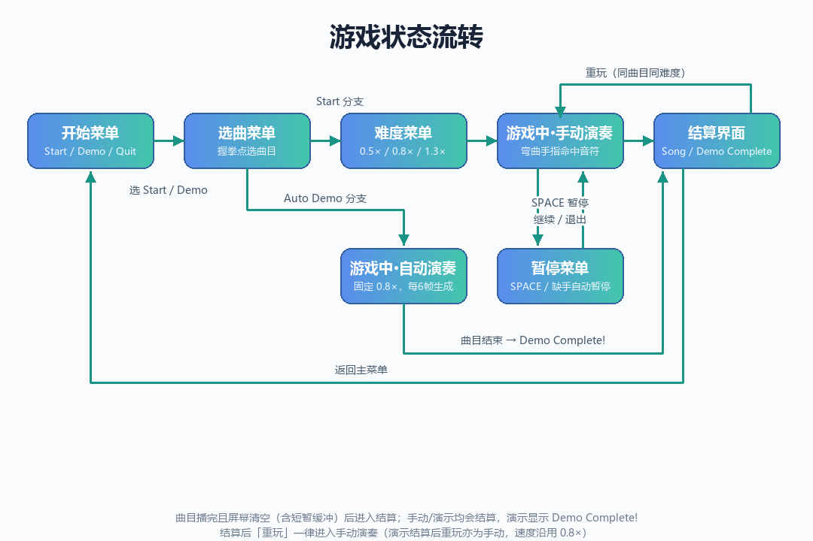

```
Start menu
  ├─ Start Game ──► Select song ──► Select difficulty ──► In game (manual play)──┐
  └─ Auto Demo  ──► Select song ───────────────────────► In game (auto play) ──┤
                                                                                ▼
                                                                          Results screen
                       ┌──────────────────┬──────────────────┐
                       ▼                  ▼                  ▼
             Replay·Manual → Manual play  Replay·Demo → Auto play  Back to main menu → Start menu
```

- **Songs**: **7** built-in — `Twinkle Twinkle Little Star`, `Happy Birthday`, `Jingle Bells`, `Farewell`, `Ode to Joy`, `Moonlight Sonata`, `Night Piano No.5`. Each is defined in `PianoSheet.get_song()` as a `(numbered-notation digit, duration)` sequence, with a `scale_notes` table translating the numbered notation into real note names (e.g. `'1'→C5`, `'b3'→Eb4`).
- **Note generation**: Generated one by one in score order; the interval is determined by the note's duration — `spawn_delay = max(1, int(20 × duration / 0.2))` frames, with a max of 30 notes on screen; the **demo mode** instead generates one every fixed 6 frames, noticeably faster rhythm.
- **Difficulty**: `Easy=0.5×` / `Normal=0.8×` / `Hard=1.3×`, **only affects note fall speed** (`speed = 5.5 × (screen height/720) × speed_multiplier`), not the generation interval; demo mode is fixed at `0.8×` and skips difficulty selection.
- **Track assignment**: Each note randomly falls into track 1–10 (`random.randint(1, 10)`), unrelated to which note it plays; the bottom label of the track is fixed as `C4…E5`, while the note shows its own real note name (`actual_note`, e.g. `C#5`). After all notes have fallen and the screen is cleared, wait a short buffer before judging the song as finished and entering the results.
- **Audio**: `get_note_sound()` looks up the corresponding `tone(N).wav` in the `Piano/` sample directory by note name; `AudioManager` uses 64 mixing channels to ensure long notes are not cut off; `stop_all()` clears all channels when paused or restarted.
- **Scoring**: `score` (with combo bonus), `combo` / `max_combo`, `perfect/great/good/miss` counts, `accuracy`, the results screen shows the rating (see the "🏆 Scoring and Rating" section below for details).
- **Control**: Controlled by triggering buttons in each menu via the cursor; auto-pause when no hand is detected during song play; keyboard control is available when necessary (see the keyboard section above). The results screen can "Replay" or "Back to main menu": after a **manual play** result, "Replay" uses the current song and difficulty to return to manual play; after an **auto demo** result, "Replay" returns to auto play (skipping difficulty selection); both can "Back to main menu".

## 🔊 Audio Playback Implementation (Core)

Every piano sound in the game comes from 88-key real samples, synthesized in real time through the chain "judgment hit → get sample → decode cache → compute volume → channel play", with sound and on-screen hit effects triggered synchronously from the same source. The complete pipeline:

```
Note enters judgment zone (manual PERFECT/GREAT/GOOD or Demo AUTO)
   → get_note_sound(actual_note, duration)
        → get_sample_file_for_note() : note name → tone(idx+1).wav
        → load_piano_sample()        : pygame.mixer.Sound decode + SAMPLE_SOUND_CACHE cache
        → compute final_volume (velocity / duration / high-note compensation)
        → AudioManager.play_sound()  : find idle channel → channel.play()
                                        → speaker
```

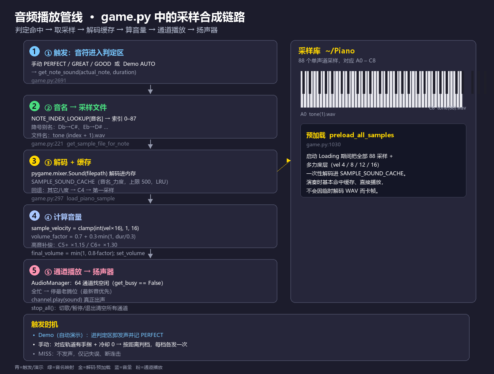

### 1. Audio engine initialization (game.py:35)

`pygame.mixer.init(frequency=44100, size=-16, channels=1, buffer=1024)`: sample rate 44.1kHz, 16-bit signed, **mono** (samples are mono themselves, saving memory and decoding); buffer 1024 frames. `pygame.mixer.set_num_channels(64)` opens **64 concurrent mixing channels**, supporting up to 64 sounds superimposed at the same instant without interrupting each other (key for trills, chords, and combos).

### 2. Sample library and note name mapping (game.py:83)

`SAMPLES_DIR = ~/Piano`, 88 files `tone(1).wav … tone(88).wav` correspond to **A0 (lowest) to C8 (highest)**. The `NOTE_NAMES_88` list + `NOTE_INDEX_LOOKUP` dictionary map note names to indices `0–87`, with built-in flat aliases like `Db→C#`, `Eb→D#`; `NOTE_TO_MIDI` / `MIDI_TO_NOTE` complete the note name ↔ MIDI number conversion (A0=21 … C8=108).

### 3. Note name → specific file (game.py:221, `get_sample_file_for_note`)

`NOTE_INDEX_LOOKUP[note]` gets the index; when not found directly, use `parse_note_name_simple()` to parse (supports numbered notation `1' 2'`, sharps/flats). File name `tone (index + 1).wav` — the list starts from 0, the file starts from 1, hence `+1`; use `os.path.exists` to confirm existence before returning.

### 4. Decode + cache (game.py:297, `load_piano_sample`)

`pygame.mixer.Sound(filepath)` decodes the WAV into a playable object (only into memory, **not played**), stored in `SAMPLE_SOUND_CACHE`, keyed by `note name_velocity`, with a **cap of 500 entries**; when exceeded, the earliest half is cleared (LRU approach) to avoid memory bloat. When no corresponding sample is found, it falls back in order: other octave of the same note name → `C4` → first sample, ensuring there is always a sound to play.

### 5. Volume computation (game.py:343, `get_note_sound`)

- `sample_velocity = clamp(int(velocity * 16), 1, 16)`: velocity layering, corresponding to different velocity-layer samples preloaded;
- `volume_factor = 0.7 + 0.3 * min(1.0, duration / 0.3)`: longer duration = louder;
- High-note compensation: `C5+` ×1.15, `C6+` ×1.30;
- `final_volume = min(1.0, 0.8 * volume_factor)`, `sound.set_volume()` only affects **this playback**, not polluting the original sample in the cache.

### 6. Channel allocation and playback (game.py:145, `AudioManager`)

`play_sound()` adds a thread lock and then: first clears finished channels (`_cleanup_stopped_channels`), then iterates over 64 channels to find an idle one with `get_busy() == False`; if all are busy, `stop()` the oldest sound to make room (newest sound priority). `channel.play(sound)` **truly starts sounding**, and registers `(note name, start time, sound, channel)` into `playing_notes` for tracking/preemption. `stop_all()` stops all channels when switching songs / pausing / quitting / restarting, clearing residual tails.

### 7. Trigger timing (game.py:2691)

Sound is produced when the note center enters the judgment zone and is hit:

- **Demo (auto play)**: Entering the judgment zone immediately calls `get_note_sound()` and records PERFECT;
- **Manual mode**: The corresponding track has a finger and the hit cooldown is 0; judges PERFECT / GREAT / GOOD by distance, and **calls `get_note_sound` once per rating tier**;
- **MISS**: No sound, only records the miss and breaks the combo.

### 8. Preload (game.py:1030, `preload_all_samples`)

During the Loading startup, all 88 samples + multiple velocity layers (vel 4/8/12/16) are decoded into the cache, so the actual play almost entirely hits the cache and plays directly, **without frame stutter from temporarily decoding WAV**.

---

## 🏆 Scoring and Rating

### 1. Hit detection and single hit score

When the note **center** enters the judgment band `[hit_line - 35, hit_line + 35]` (judgment line `hit_line = screen height - 90`, 35px above and below) and the corresponding track finger is pressed, the rating is given by the **pixel distance `distance` between the note center and the judgment line** and the score is settled:

| Rating | Distance threshold | Base score | Combo bonus | Prompt color |
| --- | --- | --- | --- | --- |
| PERFECT! | `distance < 10.5px` (15% of judgment band) | 100 | `+ combo × 5` | Green |
| GREAT! | `distance < 24.5px` (35% of judgment band) | 80 | `+ combo × 4` | Cyan |
| GOOD | `distance < 42px` (60% of judgment band) | 50 | `+ combo × 2` | Blue-purple |
| MISS | Note crosses 20px below the judgment band and is still not hit | 0 | Combo cleared | Red |

Single hit score = **base score + current combo count × coefficient**. For example, when the current combo is 20 and a PERFECT is hit, this score = 100 + 20×5 = 200. The higher the combo, the higher the single-hit gain, which is the key to chasing high scores.

### 2. Combo

- Each successfully hit note (including PERFECT / GREAT / GOOD), `combo` increases by 1, and records the session's `max_combo` (highest combo).
- When a **MISS** occurs (note missed / crossed the judgment band), `combo` immediately resets to zero.
- The combo directly participates in the bonus term of the score formula, so maintaining a long combo amplifies the total score.

### 3. Accuracy

```text
total_notes  = perfect_count + great_count + good_count + miss_count
accuracy     = (perfect_count + great_count + good_count) / total_notes × 100%
```

PERFECT, GREAT, and GOOD all count as hits; only MISS does not count.

### 4. Results rating (Rating)

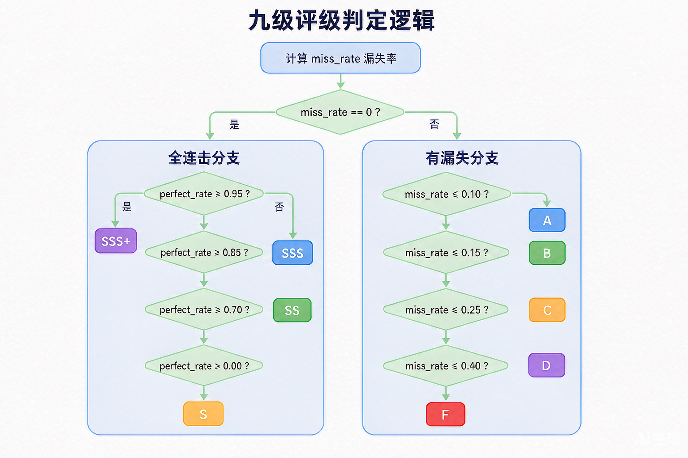

When the song ends (or the demo ends), `calculate_rating()` is called, giving the final rating based on the **miss rate `miss_rate`** and the **PERFECT rate `perfect_rate`**:

```text
miss_rate    = miss_count    / total_notes
perfect_rate = perfect_count / total_notes
```

| Rating | Condition | Meaning |
| --- | --- | --- |
| **SSS+** | `miss_rate == 0` and `perfect_rate ≥ 0.95` | Perfect Full Combo! |
| **SSS** | `miss_rate == 0` and `perfect_rate ≥ 0.85` | Excellent Full Combo! |
| **SS** | `miss_rate == 0` and `perfect_rate ≥ 0.70` | Great Full Combo! |
| **S** | `miss_rate == 0` (the rest) | Good Full Combo! |
| **A** | `miss_rate ≤ 0.10` | Great! |
| **B** | `miss_rate ≤ 0.15` | Good! |
| **C** | `miss_rate ≤ 0.25` | Fair |
| **D** | `miss_rate ≤ 0.40` | Needs Practice |
| **F** | `miss_rate > 0.40` | Keep Trying! |

> Key rules: When there is a **full combo (no MISS)**, it is subdivided by the PERFECT rate (SSS+ / SSS / SS / S); once a miss occurs, it is only rated from high to low by the miss rate (A → F). The results screen (`Assets/Song_Completed_Menu.png`) shows the score, max combo, `Perfect/Great/Good/Miss` counts, accuracy, and rating; the demo mode end shows a separate `Demo Complete!` screen (`Assets/Demo_Completed_Menu.png`).

---

## 🖼️ Game Screen Design

The game is **full screen** layout. Throughout the entire play process (menu, song selection, playing, pause, results), the **camera image is always shown** in the preview window at the bottom-right of the interface (with 21-point hand skeleton overlay, for easy calibration).

**The sidebar is only shown during song play**: The right 300px sidebar (`Assets/In_Game_Screen.png`) only appears when `in_game` and not yet entering the results screen, used to display the song name, speed, score, Perfect/Great/Good/Miss counts, and combo; in other interfaces such as menu, song selection, pause, and results, the sidebar is not drawn, only the bottom-right camera preview is kept.

The left play area contains 10 tracks that glow when triggered + falling notes with dynamic light effects (with note name labels) + hit effects and particles.

| Screen | File | Description |
| --- | --- | --- |
| Start menu | `Assets/Start_Menu.png` | Title and "Start/Demo/Quit" entries, cursor follows palm movement |
| Song select menu | `Assets/Select_Song_Menu.png` | 7-song list, select with fist |
| Difficulty menu | `Assets/Select_Difficulty_Menu.png` | Easy / Normal / Hard |
| In game | `Assets/In_Game_Screen.png` | Falling notes (with note name) + track highlight + sidebar stats |
| Pause menu | `Assets/Pause_Menu.png` | Menu overlaid when paused |
| Demo mode | `Assets/Demo.png` | No-gesture auto-play display (sidebar shows DEMO MODE) |
| Results screen | `Assets/Song_Completed_Menu.png` | Score, four counts, max combo, accuracy, and rating; "Replay" returns to manual play (same song, same difficulty) |
| Demo results | `Assets/Demo_Completed_Menu.png` | Separate interface when demo ends; "Replay" returns to auto play / "Back to Menu" returns to main menu |

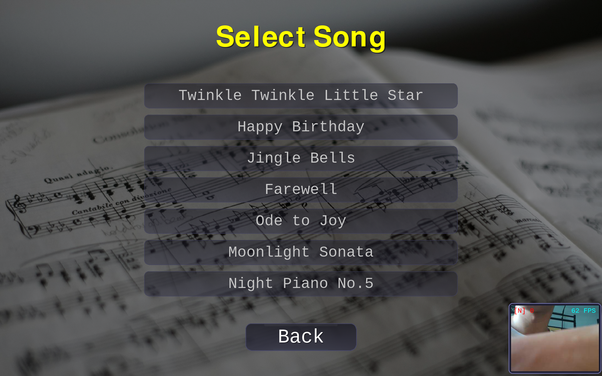
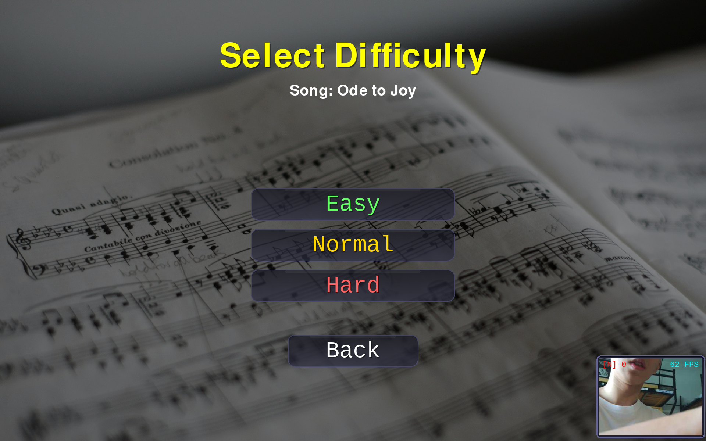
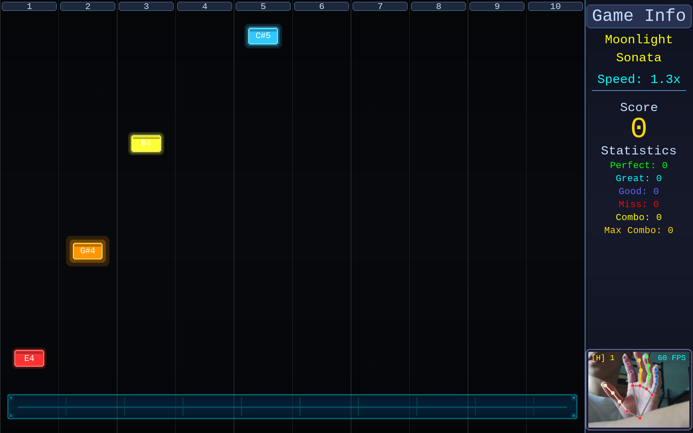
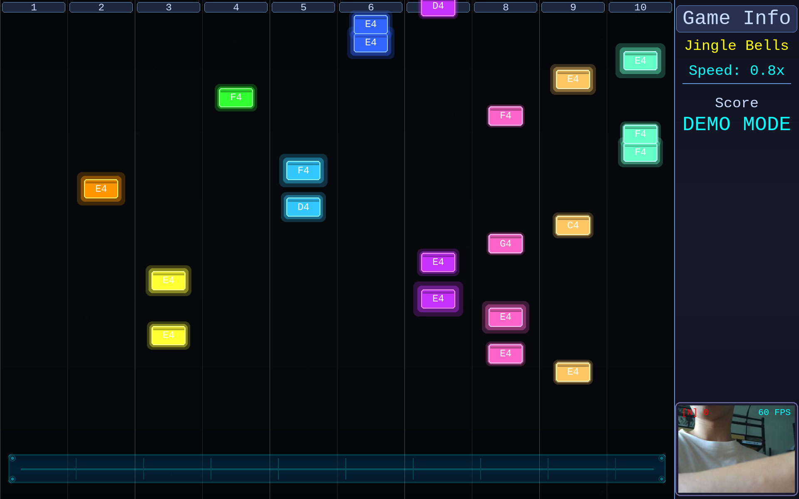
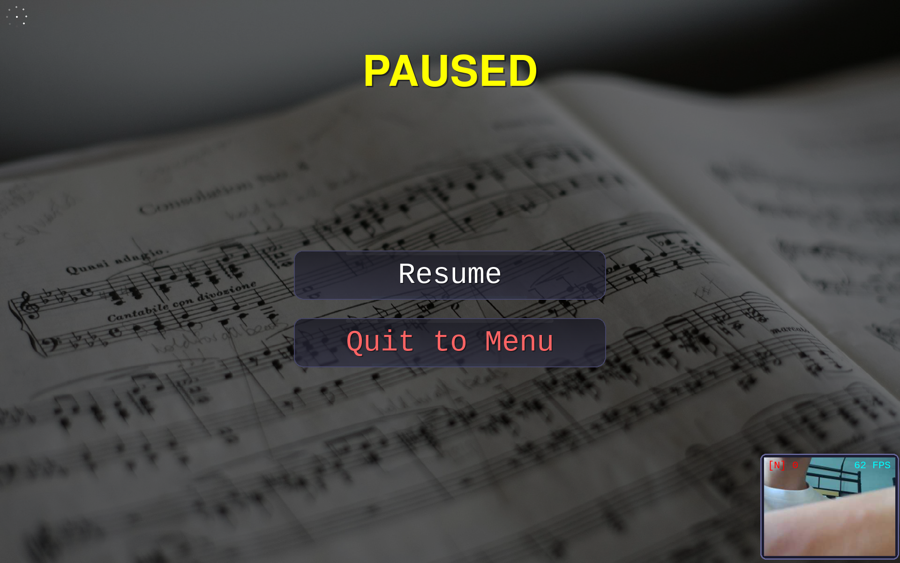
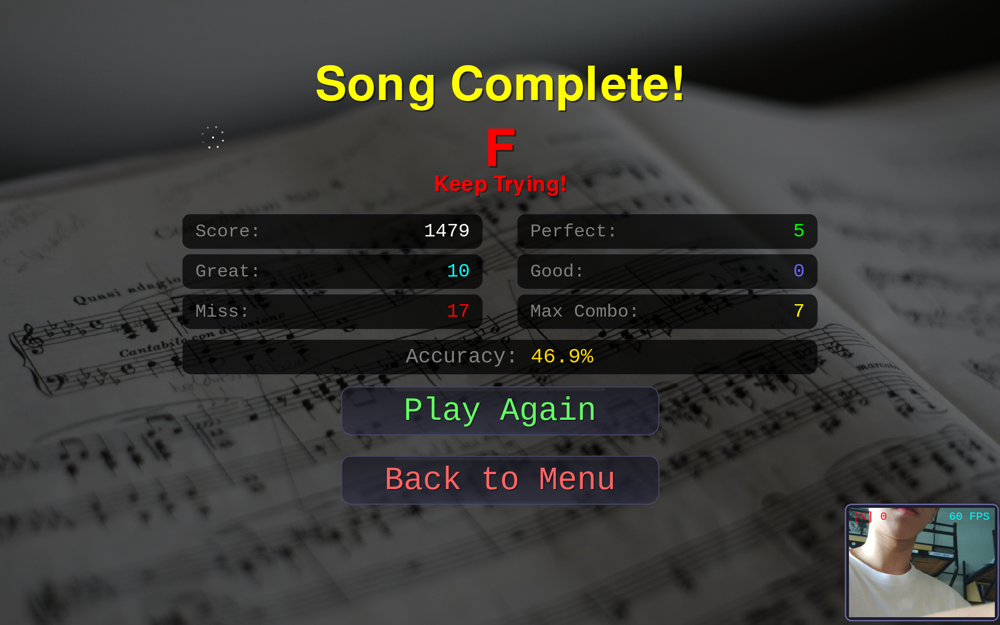
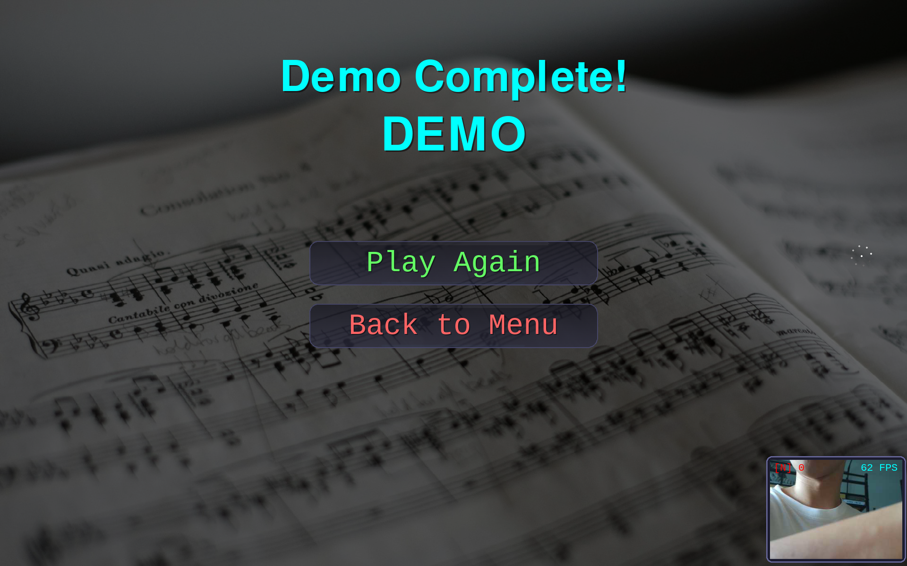

---

## 📁 Directory Structure

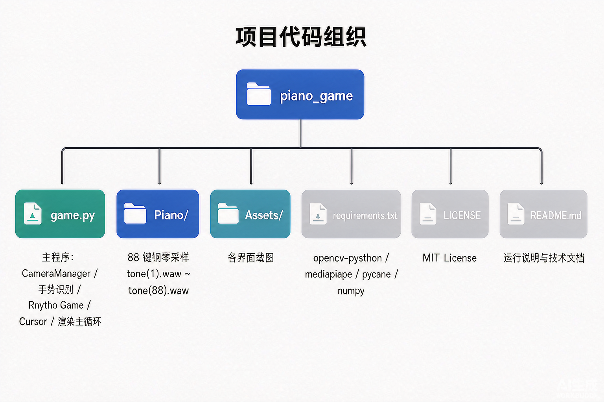

```
piano_game/
├── game.py                 # Main program: gesture recognition + game logic + rendering
├── Piano/                  # 88 piano samples tone(1).wav ~ tone(88).wav (Git LFS)
├── Assets/                 # Game screen screenshots and flowcharts (for README)
│   ├── Start_Menu.png
│   ├── Select_Song_Menu.png
│   ├── Select_Difficulty_Menu.png
│   ├── In_Game_Screen.png
│   ├── Pause_Menu.png
│   ├── Demo.png
│   ├── Demo_Completed_Menu.png
│   ├── Song_Completed_Menu.png
│   ├── bg_song.jpg               # Game background image (in repo, no network loading)
│   ├── Joint_Structure.png
│   └── diagrams/           # Technical documentation flowcharts
│       ├── gesture_pipeline.png        # Gesture recognition data processing pipeline
│       ├── game_state_flow.png         # Game state flow diagram
│       ├── audio_pipeline.png            # Audio playback pipeline diagram (sample→channel→speaker)
│       ├── cache_perf_transparent.png    # Cache and performance optimization flowchart (large text, cutout, 3D feel)
│       ├── rating_decision_tree.png    # Judgment rating branch decision tree
│       └── project_structure.png       # Project directory structure
├── requirements.txt
├── .gitignore
└── README.md
```

---

## 💾 Cache and Performance Optimization

The program uses three types of means — "**cache + startup preload + resource pool**" — for performance optimization. The core goal is only one: **make the play hot path (per frame) only do O(1) lookups and lightweight computation**, moving expensive disk reads, decoding, and redrawing to the startup phase or reusing the cache, thereby ensuring stable frame rate and audio-visual sync.

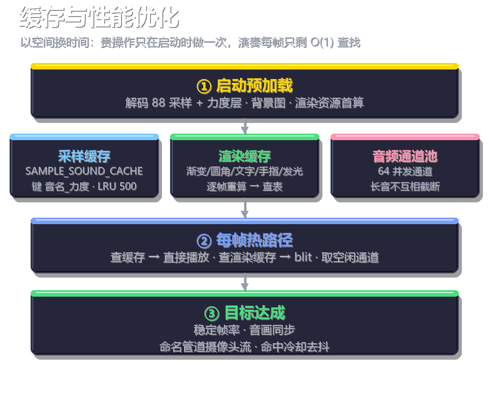

### 1. Background image (in-repo `Assets/bg_song.jpg`, no network)

- The background image `Assets/bg_song.jpg` (1920×1280) **has been committed to the repo**, **all interfaces share the same one**; at runtime it is read directly, no network download, and no `bg_cache/` cache directory is generated.
- If this file is missing, it automatically falls back to a warm gradient background (`create_fallback_bg`, see `load_bg_images`), ensuring startup in any environment.

### 2. Runtime memory cache (not persisted to disk, cleared when process exits)

**(a) Audio sample cache `SAMPLE_SOUND_CACHE`** (defined game.py:138; written in `load_piano_sample` game.py:297)

Cache the decoded `pygame.mixer.Sound` objects under `~/Piano` by **`note name_velocity`** (the same note name is split into different entries by velocity vel 4/8/12/16, corresponding to real piano samples at different touch velocities), **capped at 500 entries**, clearing the earliest half when exceeded (LRU). A cache hit returns immediately; a miss reads, decodes, and writes back:

```
get_note_sound(note name, velocity)
   └─ load_piano_sample()
        ├─ Hit SAMPLE_SOUND_CACHE[note name_velocity] ? → Return Sound directly (no disk read, no decode, microseconds)
        └─ Miss → Read disk pygame.mixer.Sound() decode → Write to cache → Return
```

When no corresponding sample is found, it automatically falls back to another octave of the same note name / `C4` / first sample, ensuring the first play also sounds and is added to the cache.

**(b) Render result cache** (avoid recomputing every frame)

- `BG_GRADIENT_CACHE` / `ROUNDED_RECT_CACHE` / `PRERENDERED_TEXTS` / `FINGER_STATE_CACHE` / `glow_cache` / `bar_fill_cache`: respectively cache the gradient background, rounded rectangles, pre-rendered text, finger states, glow, and progress bars and other high-frequency render results;
- `cached_game_bg` / `cached_game_bg_key`, `hitbox_cache` / `hitbox_cache_key`: reuse the entire game background and hitbox Surface by key, avoiding redrawing every frame.

These caches turn "per-frame recompute" into "lookup after first computation", which is the key to a stable 60fps main loop.

### 3. Startup preload (trade space for time)

- **Sample preload** `preload_all_samples` (game.py:1030): During the startup Loading, all 88 samples + multiple velocity layers (vel 4/8/12/16) are decoded into `SAMPLE_SOUND_CACHE` at once. The actual play phase **almost 100% hits the cache and returns Sound directly**, trading "Loading wait at startup" for "stable frame rate at runtime".
- Render resources (gradient / rounded corners / pre-rendered text, etc.) are also computed and cached before first use.
- **Cross-song reuse**: `SAMPLE_SOUND_CACHE` is **not cleared on song switch / replay** (only `AudioManager.stop_all()` clears playback channels, not the cache), so the whole session only pays the decode cost once.

### 4. Resource pool and throttling

- **Audio channel pool (64 channels)**: `pygame.mixer.set_num_channels(64)` (game.py:39) + `AudioManager` (game.py:145). 64 concurrent sounds don't cut each other off, avoiding dynamic allocation/lookup overhead; when all are busy, preempt the oldest sound (newest priority).
- **Named pipe camera stream**: On the Raspberry Pi, use the `rpicam-vid` named pipe to continuously stream frames (see "Camera data stream" section), avoiding reopening the camera device each time.
- **Hit cooldown (hit_cooldown = 3 frames)**: At the hit detection (game.py:2706 etc.), debounce the same note, avoiding being re-triggered by repeated detection, thus repeatedly decoding/sounding.

> Piano samples are **not** cached in the repo; they are always read in real time from `~/Piano` (the `Piano/` under the user's home directory), and reused in memory via `SAMPLE_SOUND_CACHE`.

---

## 🎵 Mapping of Sheet Music and 88-key Audio

### 1. How 88-key samples correspond to notes

`game.py` binds the 88 wavs one-to-one with standard note names: `NOTE_NAMES_88` is arranged from **A0 (MIDI 21)** to **C8 (MIDI 108)**, and `tone(1).wav` ~ `tone(88).wav` correspond in order. Through `NOTE_INDEX_LOOKUP` / `NOTE_TO_MIDI`, a three-way lookup of "note name (including `Db`/`Eb` and other flat aliases) ↔ index ↔ MIDI number" is completed, so sharp/flat notes can also correctly hit the sample.

### 2. How the numbered notation in the sheet music falls onto specific notes

Each song is described in `PianoSheet.get_song()` with "numbered notation digit + octave symbol", e.g. `'1'`, `'5'`, `'1''` (one octave higher), `'6'`, `'7'`, with a `scale_notes` mapping table translating the numbered notation digits into real note names with octave:

| Song | Key | scale_notes example | Description |
| --- | --- | --- | --- |
| Twinkle Twinkle | C | `1→C4, 2→D4 … 7→B4` | C major, middle register |
| Happy Birthday | C | `5→G4 … 1'→C5 … 4'→F5` | Includes higher octave |
| Jingle Bells | C | `1→C4 … 5→G4` | C major five notes |
| Farewell | C | `7̣→B3 … 1→C4 … 4'→F5` | Includes low B3, range B3–F5 |
| Ode to Joy | C | `1→C4 … 7'→B5, 1''→C6` | Range C4–C6 |
| Moonlight Sonata | C#m | `3→E4, 5→G#4 … 3'→E5` | Sharp key (includes G#/D#) |
| Night Piano No.5 | C | `1→C4 … b3'→Eb5 … b7''→Bb6` | Includes flats (Eb/Bb), range C4–Bb6 |

The game loop drops notes one by one according to the `notes` list (each element is `(numbered notation digit, duration)`); when the player hits, first use `parse_note_name_simple()` to parse the numbered notation digit into `(note name, octave)`, then map via `get_sample_file_for_note()` to `tone(n).wav` and play, thus realizing the closed loop of "numbered notation → real piano sample".

### 3. Sheet music source

> The built-in songs (Twinkle Twinkle / Happy Birthday / Jingle Bells / Farewell / Ode to Joy / Moonlight Sonata / Night Piano No.5, etc.) are manually compiled by the author based on **online sheet music in numbered notation**, converted into the above numbered notation digit format, for demonstration and learning only; copyright belongs to the original song authors.

---

## 🚧 Current Issues

- The background could be changed to a **dynamic background** (e.g. flowing gradient, particles) instead of the current static/single-image background.
- Different sound effects could be played when different buttons take effect (e.g. confirm/back/song-select prompt sounds), improving interaction feedback.

---

## 📄 License

This project is open-sourced under the MIT License, see [LICENSE](LICENSE).

Piano sample source: [open-source-toolkit/870f3](https://gitcode.com/open-source-toolkit/870f3.git), copyright belongs to the original author, for learning and non-commercial use only.
